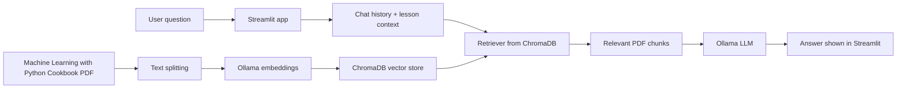

# AI ML Teacher

AI ML Teacher is a local Retrieval-Augmented Generation (RAG) Streamlit app that answers machine learning questions using the book *Machine Learning with Python Cookbook* as its knowledge base. The app runs entirely on your machine with Ollama, LangChain, ChromaDB, and Streamlit.

## What this project does

This app acts like an interactive ML tutor:

- It loads a PDF textbook from `data/pdfs/`.
- It splits the text into chunks and embeds them with an Ollama embedding model.
- It stores those embeddings in a local Chroma vector database under `data/chroma_db/`.
- When a user asks a question, it retrieves the most relevant chunks and sends them, along with the chat context, to a local Ollama chat model.
- It also shows a syllabus with day-by-day learning topics for structured study.

## Main features

- Local LLM chatbot powered by Ollama
- RAG over a PDF textbook
- Persistent vector store with ChromaDB
- Learning syllabus with daily lessons
- Chat history support inside Streamlit session state
- Source document snippets for transparency

## Architecture

The app uses a standard RAG pipeline:



### Component breakdown

**`app.py`**  
Main Streamlit UI. It renders the sidebar, lesson selector, chat interface, and response display. It also keeps user conversation state in `st.session_state`.

**`pdf_loader.py`**  
Loads the PDF, splits it into chunks with `RecursiveCharacterTextSplitter`, creates embeddings with Ollama, and builds or loads the local Chroma vector store.

**`rag_chain.py`**  
Creates the conversational retrieval chain using a local Ollama model, a custom prompt, and the Chroma retriever. It also checks whether Ollama is running and whether the required models are available.

**`config.py`**  
Central place for runtime configuration such as model names, PDF path, Chroma directory, chunk size, overlap, retrieval depth, and temperature.

**`syllabus.py`**  
Contains the 30-day lesson plan shown in the app sidebar.

**`data/pdfs/`**  
Stores the source PDF used for retrieval.

**`data/chroma_db/`**  
Stores the generated vector database so the PDF does not need to be re-embedded every time.

## How the RAG flow works

1. The PDF is loaded from `data/pdfs/Machine_Learning_with_Python_Cookbook.pdf`.
2. The text is split into overlapping chunks.
3. Each chunk is converted into an embedding using `nomic-embed-text` through Ollama.
4. The embeddings are stored in ChromaDB for fast similarity search.
5. When the user asks a question, the app retrieves the top matching chunks.
6. Those chunks, plus chat history and lesson context, are sent to `llama3:8b` through Ollama.
7. The model returns an answer and optional source snippets.

## Requirements

- Python 3.10+ recommended
- Ollama installed locally
- The following Ollama models pulled locally:
  - `llama3:8b`
  - `nomic-embed-text`
- A PDF file at `data/pdfs/Machine_Learning_with_Python_Cookbook.pdf`

## Local setup

### 1. Clone or download the project

```bash
git clone <your-repo-url>
cd ml_teacher_bot
```

### 2. Create and activate a virtual environment

Windows PowerShell:

```powershell
python -m venv venv
.\venv\Scripts\Activate.ps1
```

### 3. Install Python dependencies

```bash
pip install -r requirements.txt
```

### 4. Start Ollama

Make sure Ollama is running before launching the app:

```bash
ollama serve
```

In a separate terminal, pull the required models:

```bash
ollama pull llama3:8b
ollama pull nomic-embed-text
```

Verify the models are available:

```bash
ollama list
```

### 5. Add the PDF if needed

Place the textbook PDF at:

```text
data/pdfs/Machine_Learning_with_Python_Cookbook.pdf
```

If you want to use a different PDF, update `PDF_PATH` in `config.py` or set it through environment variables.

### 6. Run the app

Use the workspace virtual environment to start Streamlit:

```powershell
.\venv\Scripts\python.exe -m streamlit run app.py
```

Open the app in your browser at:

```text
http://localhost:8501
```

## Configuration

You can override most runtime settings with environment variables in a `.env` file:

- `OLLAMA_MODEL` defaults to `llama3:8b`
- `OLLAMA_EMBEDDING_MODEL` defaults to `nomic-embed-text`
- `OLLAMA_BASE_URL` defaults to `http://localhost:11434`
- `PDF_PATH` defaults to `data/pdfs/Machine_Learning_with_Python_Cookbook.pdf`
- `CHROMA_PERSIST_DIR` defaults to `data/chroma_db`

## Notes on first run

- The first question may take longer because the app may need to build or load the vector store.
- If `data/chroma_db/` already exists, the app reuses it instead of re-embedding the PDF.
- If the PDF or Ollama models are missing, the sidebar will show a status warning.

## Troubleshooting

**Ollama is not running**  
Start it with `ollama serve`.

**Model not found**  
Pull the model again with:

```bash
ollama pull llama3:8b
ollama pull nomic-embed-text
```

**PDF not found**  
Make sure the source file exists at `data/pdfs/Machine_Learning_with_Python_Cookbook.pdf`.

**Vector store issues**  
Delete `data/chroma_db/` and restart the app to rebuild the embeddings.

## Project structure

```text
ml_teacher_bot/
├── app.py
├── config.py
├── pdf_loader.py
├── rag_chain.py
├── syllabus.py
├── requirements.txt
├── README.md
└── data/
    ├── pdfs/
    │   └── Machine_Learning_with_Python_Cookbook.pdf
    └── chroma_db/
```

## License

Add your preferred license here if you plan to publish the project.